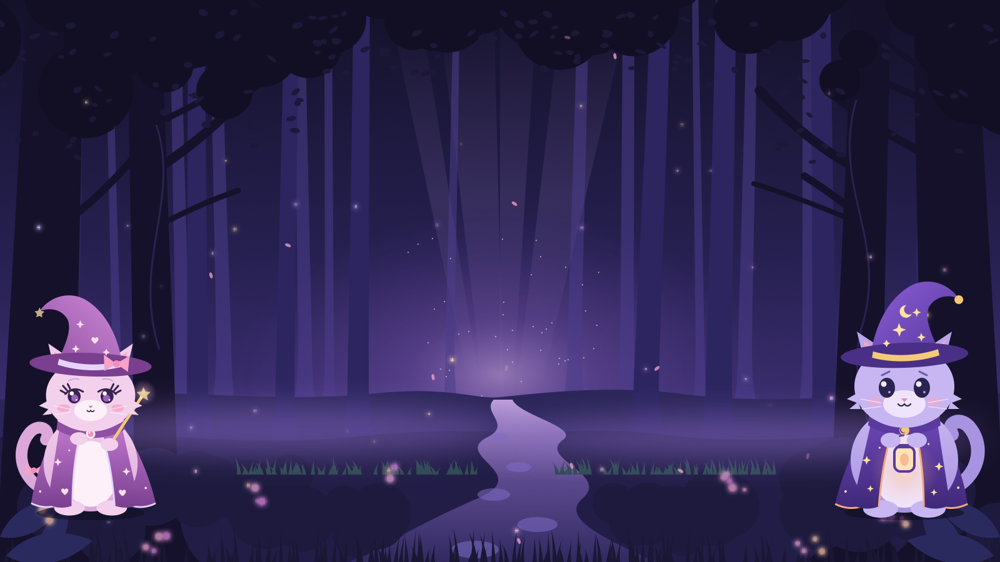

# The Furries of Whimsical Forest

A cozy, whimsical theme for Claude. Install it as a Claude Code plugin and the
Claude desktop app takes on an orchid and lavender look built on Catppuccin
Macchiato, with a moonlit violet forest drifting behind your chats.



- **A soft dark palette:** violet-tinted surfaces, orchid accents and links,
  lavender highlights and warm peach lamplight. Body text meets WCAG AA
  contrast, with no harsh pure black or white.
- **A living forest:** fireflies drift and twinkle, petals tumble down, mist
  rolls along the ground and a glowing path leads into the trees.
- **Two Furries for company:** a mage cat with a twinkling star wand in the
  bottom-left corner, and a wizard cat with a glowing lantern in the
  bottom-right. They bob, blink and swish their tails, and stay in their
  corners as the window resizes.
- **Readable over the art:** frosted panels and near-solid message bubbles
  keep your conversation clear.

All artwork is original vector art, drawn for this theme.

## Install

At the prompt of a Claude Code terminal session:

```
/plugin install whimsical-furries --marketplace reine/whimsical-furries
```

Answer `y` to add the marketplace, then pick a scope (user is the usual choice).

Or from a shell:

```bash
claude plugin install whimsical-furries --marketplace reine/whimsical-furries
```

In the desktop app, where `/plugin` does not run: click **+** next to the prompt
box, then **Plugins**, **Add marketplace** with `reine/whimsical-furries`, then
**Add plugin**.

The theme appears in the desktop app once a session starts, after its first
message. Sessions that were already open pick it up after `/reload-plugins`.

## Turn it off

```bash
claude plugin disable whimsical-furries@whimsical-furries
```

Use `enable` to bring it back, or `uninstall` to remove it.

## Notes

- The theme is dark only and draws in the Claude desktop and mobile apps, not the terminal.
- The animation is slow and gentle. With Reduce Motion on, the scene shows as a still picture.

## License

The code is under the [MIT License](LICENSE). The artwork, everything in `art/`
plus `hooks/forest.ts` (generated from it) and `docs/preview.png`, is under
[CC BY-NC 4.0](art/LICENSE): share and remix it with credit, but not for
commercial use.

## Editing the art

The scene lives in `art/`: `forest.svg`, `cat-wizard.svg` and `cat-mage.svg`.
After editing any of them, run `python3 art/compose.py` to rebuild
`hooks/forest.ts`.
